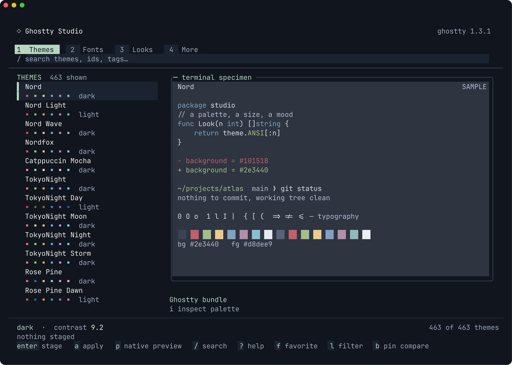

# Ghostty Studio

Make the terminal yours. A native TUI built with [Bubble Tea](https://github.com/charmbracelet/bubbletea), Bubbles, and Lip Gloss.



Search a palette. Pick a font. Make a Look. Go deeper when you need to.

## Start

```sh
make install
ghostty-tui
```

Requires Go 1.25+ to build and Ghostty for validation and font discovery. Homebrew is needed only for optional font installation. This release is tested on macOS with Ghostty 1.3.1; native preview and the font installation shelf are designed for macOS.

The binary installs to `~/.local/bin/ghostty-tui`, with assets in `~/.local/share/ghostty-studio/assets`. Keep `~/.local/bin` on your shell's PATH. There is no background service or network activity on startup. The archived Rust app stays in its original location.

## A little at a time

| Surface | What you can do |
|---|---|
| **1 Themes** | Search the installed Ghostty and local catalogs, inspect color swatches and contrast, favorite palettes, filter dark/light, pin a comparison. |
| **2 Fonts** | Choose an installed family while retaining fallback coverage. Open Discover for curated Homebrew installs and license information. |
| **3 Looks** | Start with Everyday, Daylight, Dense, Presentation, or After Hours. Save your own combinations; import and export appearance-only JSON. |
| **t Tune** | Adjust the few settings relevant to the current screen: size, spacing, opacity, cursor, and typography. |
| **4 More** | Explore effect stacks, the searchable native settings reference, workflow presets, configuration health, and palette export. Use `[` / `]` to move between these pages. |
| **i Inspect** | Read the proposed values and staged diff before applying. |

The test machine supplies 463 themes and 200 distinct settings through the installed Ghostty. Catalog sizes follow your installation rather than a hardcoded theme list.

Three original, subtle effects are included: Soft Glow, Paper Grain, and Soft Scanlines. The 21 recovered shaders are preserved separately in `assets/legacy-shaders`; they are not automatically enabled. Shader composition preserves order and offers an explicit reset.

The workflow shelf includes Quick Terminal, command notifications, working-directory inheritance, Option-as-Alt, and scrollback search. Palette export supports Ghostty, JSON, and an fzf shell snippet that you can inspect and adopt yourself.

## Keys

| Key | Action |
|---|---|
| `1`–`4`, `Tab`, `Shift+Tab` | Change section |
| `↑` / `↓`, `j` / `k` | Move |
| `/` | Search; `Enter` keeps the query, `Esc` clears it |
| `Enter` | Stage the selected item |
| `a` | Validate, back up, and save staged changes |
| `u` | Undo the previous saved change |
| `p` | Launch an isolated native Ghostty specimen |
| `t`, `i`, `?` | Tune, inspect, help |
| `f`, `l`, `b` | Favorite, filter, pin comparison in Themes |
| `d`, `I` | Discover fonts, review a font installation |
| `s`, `e`, `o` | Save, export, import in Looks |
| `Space`, `x` | Toggle an effect, clear the stack |
| `q` | Quit; offers to discard unapplied changes |

The interface adapts to terminal size; 120 × 36 cells gives the specimen room to breathe. `?` reveals the keys relevant to your current screen.

Roomy terminals show theme names above separated palette swatches; compact windows keep a single row per item. The [font specimen](docs/screenshots/fonts.png) exposes alphabets, ambiguous glyphs, weights and ligatures. [Looks](docs/screenshots/looks.png) show their font, size, padding and opacity together, while [Help](docs/screenshots/help.png) keeps its controls visible as you scroll.

## Saved means saved

Browsing and staging do not change Ghostty. Apply validates through the installed Ghostty binary, backs up affected files, and appends a managed `studio.ghostty` include to the winning configuration. Comments, unknown settings, and existing include files are preserved. Source hashes prevent a stale edit from overwriting a change made elsewhere. Undo restores the previous files byte for byte and refuses to overwrite outside edits.

On macOS, both the XDG configuration and `~/Library/Application Support/com.mitchellh.ghostty/` may be active. Studio discovers their precedence and reports the sources in Health. `config.ghostty` takes precedence over `config` within a directory.

**After Apply or Undo, reload Ghostty with `Cmd+Shift+,`.** Some settings need a new window or an application restart. The interface reports save success separately from reload requirements.

Inline specimens show real palette colors but use the font of the terminal hosting Studio. Press `p` for an isolated Ghostty window with the proposed font and effects. Preview uses a temporary configuration; it does not change your default appearance. Native window inspection was unavailable during this build, so the launch recipe is covered by tests, while actual font and shader rendering still needs visual confirmation in Ghostty. Configuration validation alone does not compile GLSL.

Favorites, Looks, previews, and undo history live in `~/.config/ghostty-studio` by default, or under `$XDG_STATE_HOME/ghostty-studio` when set. Global CLI options can select explicit configuration, state, executable, and asset paths.

## CLI

```sh
ghostty-tui themes rose
ghostty-tui fonts --discover
ghostty-tui fonts --install font-maple-mono
ghostty-tui diff --theme 'Rose Pine'
ghostty-tui apply --theme 'Rose Pine' --font 'Monaspace Neon'
ghostty-tui apply --set background-opacity=0.95
ghostty-tui undo
ghostty-tui doctor
ghostty-tui look save 'My reading room'
ghostty-tui look export 'My reading room' reading-room.json
ghostty-tui look import reading-room.json
ghostty-tui export --format fzf
```

Global options go **before** the command. For an isolated test:

```sh
ghostty-tui --config /tmp/example/config.ghostty --state-dir /tmp/example/studio
```

Run `ghostty-tui --help` for all commands. `snapshot` renders the same Bubble Tea View to ANSI output for deterministic visual review; screenshots are terminal output, not HTML mockups.

## Development

```sh
make build
go test ./...
go test -race ./...
go vet ./...
```

Core tests cover native argument handling, include order, repeated values, config injection, stale edits, atomic writes, undo, catalogs, and font installation outcomes. UI tests cover rendering dimensions, keyboard navigation, staging, errors, and engine integration. CLI integration tests use a real Ghostty binary when available and write only temporary fixtures.

See [verification results](docs/VERIFICATION.md), [verified sources](docs/SOURCES.md), [legacy audit](docs/LEGACY-AUDIT.md), and [build brief](docs/BUILD.md). Code and new effects are MIT licensed. Recovered assets retain their original notices; installed fonts retain their upstream licenses.
